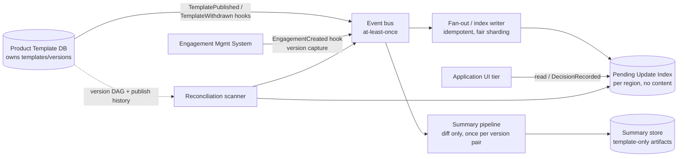
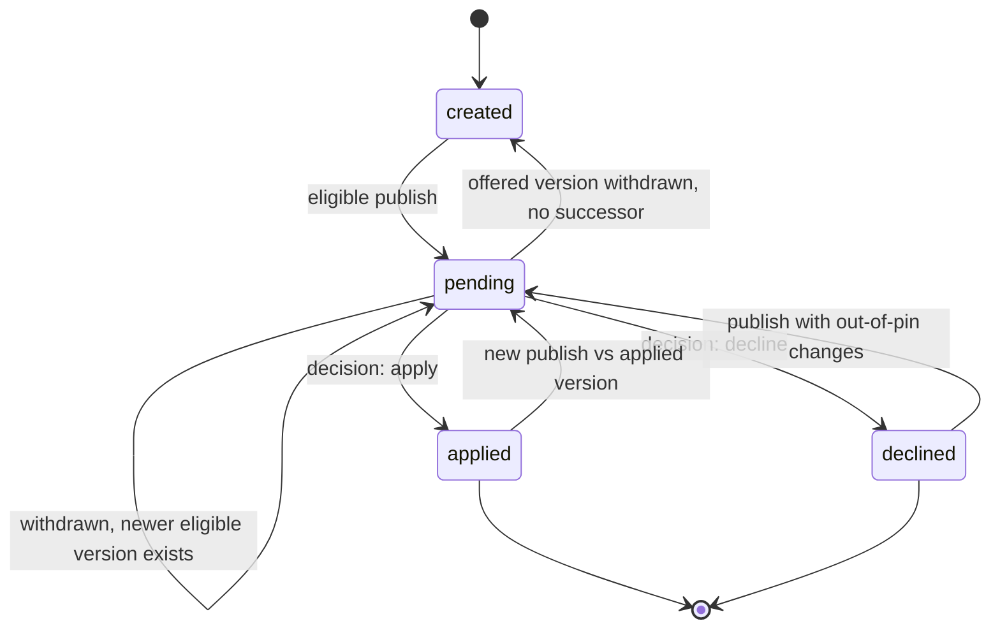

# Design: Pending Template Update Notification System

**Version**: 1.0 | **Date**: 2026-10-17 | **Status**: Ready for review

Customers work in Engagement Files created from Product Templates that content teams
update year-round. This design covers a notification and evaluation system that tells
customers, per Engagement File, that a newer eligible template version exists, shows a
human-readable summary of the changes, and records an apply or decline decision.
Out of scope: applying template content to a file and UI mockups.

Scale context: ~4,000 firms; ~800,000 active engagement files; 40 products; median ~40
and largest ~40,000 engagements per firm; ~1 template publish per product per week
(~40/week). Freshness target: publish-to-pending p99 < 60 seconds. Monthly run budget,
including LLM inference: USD 5,000. The shared engagement-loading dependency takes
~1 minute per file, is owned by another team, and engagements are not directly
queryable — so this design never puts that load on the publish hot path.

## 1. Architecture and data ownership

### Diagram description

| Node | Meaning |
|------|---------|
| Product Template DB | Owns templates, versions, diffs. Shared across firms. No engagement knowledge |
| Engagement Mgmt System | Owns engagement lifecycle + content. Fires creation hook |
| Event bus | Transport only. Labeled at-least-once — consumers must dedupe |
| Fan-out / index writer | Consumes publish/create events, computes eligibility, writes index rows |
| Summary pipeline | Generates human-readable summary from diff only, once per version pair — never per engagement |
| Summary store | Holds template-only artifacts + lineage |
| Pending Update Index | Derived index. Labeled per region, no content — residency |
| Application UI tier | Reads index; emits decision back |
| Reconciliation scanner | Finds missed events, repairs gaps |

### Notes

| Datum | Owner | Store | May leave region? |
|-------|-------|-------|-------------------|
| Templates, versions, diffs, publish log | Product template team | Shared product template DB | Yes (not firm-specific) |
| Engagement content, workpapers | Customer / engagement system | Customer-scoped DBs | **No** |
| Update summaries + lineage | Notification platform | Summary store (central, replicated) | Yes — template-only by construction |
| Pending/decision index rows | Engagement-management side | Pending Update Index, written in the engagement's region (EU/CA/default) | Metadata only, in-region |

Cross-system interaction is hooks and events only; no component queries another
team's storage. The Pending Update Index holds minimal rows (engagement_id, firm_id,
product_id, current_version, offered_version, state, decision, pinned_ranges,
summary_key, publish_ids, updated_at). It contains no engagement content — only the
identifiers the platform already handles. It is derived and rebuildable: a cache of
facts recomputable from creation-time version capture plus the template version DAG,
so index loss is recoverable, never a data-loss event.

**Key mechanism — creation-time capture.** When an engagement is created, a hook
writes its (engagement_id, product_id, template_version) into the index immediately.
This is how the system learns every engagement's current template version without the
1-minute load. After backfill, the publish hot path touches only the index.

## 2. Correctness and production evolution

**Event model.** All events are at-least-once; duplicate, delayed, and reordered
delivery is assumed. Every consumer is idempotent on natural keys: index writes on
(engagement_id, offered_version, state, row_version); event handling on publish_id /
withdraw_id / engagement_id. Replaying any event yields the same end state; duplicate
publish deliveries produce no double rows and no double-counted metrics.

**State model.** Per engagement: `created → pending → applied | declined`, plus
re-pending when newer changes arrive outside all pins.

**Decline pins an ancestry range.** A decline stores the set of version ancestors
reachable from the offered version back to the engagement's current version. A later
offered version whose changes are entirely inside a pinned range does not re-open as
pending; changes outside every pin do. Example: a firm declines v5; v7 later ships
v5's changes plus new ones — the file shows pending with a summary covering only the
new changes, and the decline remains on record. Ancestry range was chosen over exact-
version pin (v7 would re-prompt identical content) and content-hash pin (same
behavior, heavier storage and comparison) because it is deterministic on the version
DAG the template DB already owns.

**Withdrawn versions.** A withdrawal event supersedes pending state that offers the
withdrawn version: the row moves to `created`, or re-offers the next eligible non-
withdrawn version if one exists. Withdrawn versions are never offered for decision;
recorded decisions on them are preserved as history.

**Accumulated updates.** offered_version always points at the newest eligible version;
the summary covers current_version → offered_version as one combined change set;
settled publish_ids retained for lineage. Rapid successive publishes converge to the
newest eligible version without thrashing (row_version compare-and-set).

**Missing events.** An hourly reconciliation scan compares the template DB's publish
history against per-publish index coverage and enqueues repair for gaps; engagement
loads are used only where capture data is absent, from the bounded reconciliation
pool. Gaps alert, never silently drop.

**Failure recovery.** Index writes retry with bounded backoff; exhausted work lands in
a dead-letter queue with an alert. The index is rebuildable end-to-end (replay
publish history × re-capture), so crash, bad deploy, or regional index loss recovers
without data loss. Contract changes are expand/migrate/contract; the system runs live
with no maintenance window, and pre-feature engagement files are covered by backfill
(see Migration and backfill).

## 3. Scale, cost, and operational characteristics

**The capacity rule.** The ~1-minute engagement load never sits on the publish-to-
pending hot path. Hot-path work is: consume event, resolve eligibility from the
index, look up a pre-generated summary, batch idempotent index writes. Typical publish
(800,000/40 = 20,000 eligible rows): zero engagement loads; ~20,000 index writes;
p99 < 60s comfortably met (ingest < 5s, eligibility < 10s, summary pre-warmed in
parallel < 30s, writes < 10s, buffer).

**Where loads are used, and the arithmetic** (baseline downstream concurrency C = 20
concurrent 1-minute loads — placeholder to confirm with the owning team; math scales
linearly):

| Scenario | Loads | Time at C = 20 |
|----------|------:|----------------|
| Routine publish (hot path) | 0 | Freshness from queue + index writes only |
| Backfill, 800,000 engagements | 800,000 | 800k min ÷ 20 = 40,000 min ≈ **27.8 days** (resumable, can pace slower) |
| Largest firm, 40,000 uncaptured rows (pre-backfill worst case) | 40,000 | 2,000 min ≈ 33 h; round-robin across firms so median-40 firms interleave; post-backfill = 0 |
| Reconciliation of residual gaps | small subset | Scanner throttled to stay under C |

Worst full recompute (e.g. topology change affecting one product across all firms):
800,000 index writes at ~500 writes/s aggregate ≈ 27 minutes staged; governed by the
coverage SLO, not the 60s freshness SLO, and flagged as degraded mode. Fan-out
admission is per-firm round-robin with per-firm in-flight caps and backpressure
(pause admission when downstream slows); checkpoints live outside process memory, so
backfill and fan-out resume after any interruption.

**Monthly cost vs USD 5,000 budget** (40 publishes/week ≈ 173/month):

| Category | Typical month | Backfill month |
|----------|--------------:|---------------:|
| LLM inference (~190 calls × ~$0.50, version-pair cached) | $95 | $95 |
| Compute (worker; light queue + writes) | $150 | $400 |
| Storage (~0.8 GB index + lineage) | $15 | $15 |
| Network (publish payloads, summary replication) | $20 | $20 |
| Contingency / capacity reserve | $120 | $285 |
| **Total** | **≈ $400** | **≈ $815** |

Headroom exceeds 6× even if every line is underestimated 4×. Cost is dominated by
neither engagements (no per-engagement inference) nor publishes (index writes are
cheap); the budget holds.

**Operational characteristics.** Single-region-independent workers; per-region index
writers; fair sharding by firm; feature flags per product and per firm for staged
enablement and halt (halt fan-out for one firm within 5 minutes, no redeploy; resume
from checkpoints without duplicates). See Observability and SLOs.

## 4. LLM summary generation and evaluation

Summaries are generated **once per version pair** (product_id, from_version,
to_version) — never per engagement — from the structural JSON diff of the two template
versions. Template zips are already diffable by an existing reliable comparator; the
diff (add/remove/modify path lists) is the sole LLM input. No engagement data is ever
present in a prompt, by construction: the pipeline's input is the diff object, and
the engagement systems are not on its call path.

**Pipeline.** On TemplatePublished: resolve diff → look up existing summary for the
pair → if absent, generate with a pinned prompt version and model → store summary
text plus lineage (diff_hash, prompt_version, model_id, generated_at, generator_run)
→ fan-out references summary_key. Non-LLM structural fallback (counts of sections
added/removed/modified in plain language) is emitted if the model endpoint is
unavailable, so freshness never depends on inference availability.

**Reproducibility.** Same (diff_hash, prompt_version, model_id) must yield a
byte-identical or versioned-equal summary; regeneration is blocked from silently
using a newer prompt/model — upgrades are explicit version bumps with re-generation
of new pairs only, old summaries retained as shown.

**Evaluation.** A defined, repeatable quality method: sampled human review (e.g. 20
summaries/month) against a rubric (accurate change coverage, plain language,
non-technical) with a pass threshold (≥ 95% rated understandable and accurate) and
recorded results. Failed samples trigger prompt-version review.

**Defending a March summary in a November review.** Stored lineage records template
versions (diff_hash), prompt and model (prompt_version, model_id), run identity and
time (generator_run_id, generated_at), and the archived input diff and output text —
an auditor can re-execute generation from archived inputs and compare. Lineage
completeness is a monitored metric (100% complete).

## 5. Tradeoffs, assumptions, and challenge

**Tradeoffs.** (1) Pending Update Index vs compute-on-read: chose the index — pays
eventual-consistency and rebuild-tooling complexity, buys p99 < 60s and the cost
budget (compute-on-read cannot survive 1-minute loads). (2) Central summary generation
vs in-region: chose central for template-only diffs — pays an audit burden to prove
no engagement content enters prompts (enforced by call-path construction), buys
reproducibility and one summary per version pair. (3) Creation-time capture vs load-
on-demand: pays a new hook dependency on engagement creation, buys removing the
shared downstream from the hot path.

**Assumptions and impact if wrong.** Downstream concurrency limit (C = 20 baseline;
owner confirmation pending): capacity and backfill duration scale linearly; freshness
unaffected (hot path is load-free). Update frequency (~40/week): 10× burst multiplies
fan-out volume — queueing and backpressure absorb it; freshness p99 re-measured.
Budget USD 5,000/month: current estimate ≈ $400–815; overruns would force summary
caching/model downgrades — currently >6× headroom. Diff capability exists and is
quick: yes, per platform; if it regressed, summaries fall back to structural counts.
Existing auth/observability/event transport reused: schedule and cost assume no new
identity system. Template content not firm-specific: enables central generation; if
that ever changed, summaries would generate in-region per residency zone at modest
extra cost. No maintenance window: every change expand/migrate/contract, staged.

**Riskiest element.** Capture-at-creation completeness. If the EngagementCreated hook
misses rows (or historical rows lack capture), correctness depends on backfill and
reconciliation, and the index is rebuildable — but this is the component whose
operational failure most degrades freshness. Mitigations: backfill is mandatory
before relying on coverage; hourly reconciliation; rebuild runbook; capture-failure
metric on the engagement system's hook.

**Deliberately left out.** Applying template content to engagements; UI mockups; the
fan-out worker implementation (follow-on spec); engagement archive/retention beyond
"active"; per-engagement personalized summaries.

**The requirement we would challenge.** The p99 < 60s freshness target. Template
publishes are weekly editorial events; 5–15 minutes would cut burst engineering
noticeably. It is kept because the spec fixes it and the architecture makes it cheap:
the hot path is index-only, so 60s is a queue-latency budget, not a capacity budget.

## Observability and SLOs

- **Freshness SLO**: publish-to-pending p99 < 60s, measured per publish_id (ingest
  timestamp → first affected index write).
- **Coverage SLO**: every publish eventually reaches every eligible engagement; lag
  per publish_id; unprocessed rows after 24h breach the SLO and alert.
- **Signals**: ingest lag, fan-out progress/rate, retry and DLQ counts, reconciliation
  gaps, downstream saturation, summary success/failure, index write errors,
  capture-hook failures.
- **Alerts** (fire within 5 minutes of onset): freshness burn, coverage breach, DLQ
  non-empty, backfill stalled, downstream saturation — naming publish_id and
  unprocessed counts where applicable. Logs, metrics, and traces carry identifiers
  only, never engagement content or client-identifying material.

## Data residency (EU, Canada)

Engagement content never leaves its in-region customer store; index rows are written
in the engagement's region and hold metadata only. Summary generation runs centrally
on template diffs — not firm-specific, no customer material — and summary text is
replicated into regional indexes. An EU or Canada firm never causes workpaper bytes
to cross a region, even when its summaries were produced by a non-regional model
endpoint: the only cross-region bytes are template diffs in and summary text out. A
residency audit samples index rows, logs, and prompts and requires zero engagement-
content bytes.

## Migration and backfill

800,000 pre-feature engagements are indexed incrementally: enumerate engagements per
customer database (owner-operated export or hook replay), capture each engagement's
template version via the bounded load pool, write index rows, checkpoint externally
per batch. Rate-limited to the agreed downstream concurrency (C=20 → ~27.8 days at
full throttle; pacing is a knob, not a deadline). Resumable after any interruption;
haltable within minutes; runs alongside live traffic with no maintenance window.
Real-time fan-out runs during backfill and never queues behind its backlog (separate
pools; backfill yields first). Staged rollout via per-product/per-firm flags; halt
without redeploy; re-enable resumes from checkpoints with no duplicate or missing
rows.

## Supporting diagrams

Sources under `docs/diagrams/`: `architecture.mmd`, `event-flow.mmd`,
`state-machine.mmd`, `backfill-sequence.mmd`.
